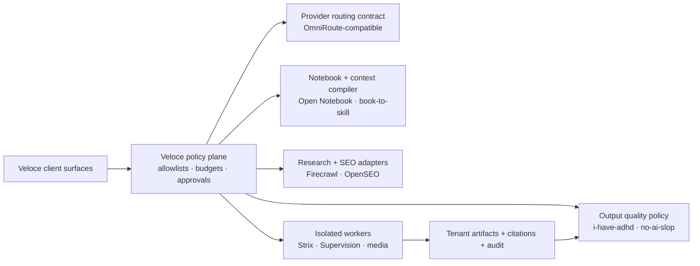

# V96 infrastructure additions — STAR plan

Date: 2026-08-10
Branch: `codex/reviewed-additions-2026-08-10`

This is the handoff plan for the parallel v96 implementation session. It is
structured as Situation → Task → Action → Result so every candidate has a
clear reason to exist, a bounded implementation, and a measurable exit gate.

This document is the single source of truth for all reviewed additions. It
replaces the former standalone reviewed-additions note.

## Implementation checkpoint (2026-08-10)

The first contract slice is now present on this branch: `src/lib/v96Contracts.ts`
defines the research-record, visual-QA, future-video-provider, and resumable
worktree envelopes; `src/lib/v96SkillPack.ts` contains seven curated Agency
Agents role manifests pinned to upstream revision `ebe9c99`; and
`tests/v96-contracts.spec.ts` locks the URL, tenant, citation, budget, and
tool-boundary invariants. The role pack is visible as a read-only catalog in
Integrations. No ScrapeGraphAI, Supervision, SkyReels, Prime Agent, or other
heavy runtime has been installed or exposed to the client cloud.

The supplied Hermes Content Factory reference is cataloged as a workflow
contract. Its public page returned HTTP 404 during this review, so the exact
upstream implementation is not treated as verified until the source is
available again.

## Situation

Veloce AgenticOS already has the product surfaces that these repositories could
strengthen: agent routing and skills, Agent Room, Agent Kanban, Flow Lab, Radar,
SEO, Leads, Video, OpenMontage, Memory, and governed tenant-cloud adapters.

The risk is infrastructure sprawl. Several candidates are complete runtimes or
GPU-heavy research projects. The v96 objective is therefore not to embed every
repository. It is to turn the useful parts into versioned, reviewable contracts
that can later be implemented by local workers or approved cloud adapters.

### Zero-setup interpretation

For v96, “zero setup” means zero client installation, external-key wiring, or
manual integration work. It does not mean that upstream providers have no
credentials, cost, model licenses, or safety requirements. Veloce owns those
operator concerns behind the policy plane and exposes only tenant-scoped
capabilities with budgets, audit records, and emergency disable controls.

The upstream repositories are therefore source material for contracts and
workers, not an auto-install list or a collection of second control planes.

### Integration and orchestration model

The client calls one Veloce capability surface. The runtime turns that request
into a durable job with a tenant id, capability id, contract version, budget,
approval state, provider policy, and idempotency key. A scheduler selects the
smallest approved worker, places it in a queue, and records progress and
artifacts. Workers have no direct access to browser credentials or unrelated
tenant data. Every result is normalized into a Veloce contract before it is
shown in a product surface.

Heavy or network-active capabilities run as disposable workers, not inside the
Next.js process:

- routing uses a Veloce-owned provider policy and an OmniRoute-compatible
  adapter;
- Notebook and book-to-skill use tenant-scoped source/artifact jobs and
  retrieval contracts;
- Firecrawl/OpenSEO/ScrapeGraphAI use bounded research adapters with citations;
- Supervision, media generation, and Strix use isolated workers with explicit
  artifact, target, and budget gates;
- i-have-adhd and no-ai-slop run as a transparent final output policy.

### End-to-end data flow

1. A client asks SEO/Research to understand a market, competitor, or product
   question. The request is tenant-scoped and budgeted.
2. The research adapter searches or reads only approved public sources. OpenSEO
   contributes SEO intelligence; Firecrawl contributes bounded content; future
   ScrapeGraphAI contributes structured extraction. All results become
   citation-bearing records.
3. The Notebook stores approved source artifacts. book-to-skill can compile a
   client-owned technical corpus into a reviewed skill, so the coding agent
   retrieves relevant sections instead of receiving the entire corpus.
4. Hermes routes the coding/research calls through the approved provider set,
   with fallback, compression, budget, and route decisions recorded.
5. The build lane produces code and media artifacts. Supervision can return
   visual-QA evidence; a governed media adapter can create approved assets;
   Strix can assess an explicit staging target in the operator security lane.
6. The result is held for the required approval, then the output policy makes
   the response direct and scannable while preserving citations, code, facts,
   and intentional voice. The user sees one Veloce workflow and one audit trail.

## Reviewed candidate portfolio

| Candidate | Product fit | Decision |
| --- | --- | --- |
| SonarQube CLI | Quality Review, coding lanes, secret leakage prevention | Recommended optional operator preflight; detect only, no auto-fix. |
| Agent Orchestrator | Agent Kanban and isolated parallel coding | Recommended operator pilot for worktree status and launch awareness. |
| Shepherd | Reversible traces and review-before-apply execution | Review next; borrow the retained-output model before adopting its alpha runtime. |
| QM | Multiplayer scopes, memory, permissions, and background work | Deferred; overlaps the hosted runtime and Paperclip. |
| Hugging Face Speech-to-Speech | Jarvis, Studio, and local/private voice | Review next after storage, latency, and consent testing. |
| Explee / AutoGTM | Leads and Outreach enrichment | Provider candidate only; human approval, cost, and opt-out controls required. |
| Infobip | SMS, WhatsApp, voice, and omnichannel delivery | Catalog now; adapter only after compliance and consent review. |
| Agency Agents | Reusable specialist roles across existing agents | Recommended curated skill-pack import; no new execution rights. |
| Roboflow Supervision | Visual QA for media and artifact review | Review as a bounded Python worker. |
| SkyReels V2 | Future long-form and image-to-video generation | Deferred to a separate GPU worker; do not install locally. |
| ScrapeGraphAI | Structured extraction for research, SEO, Radar, and Memory | Recommended allowlisted research adapter beside Firecrawl. |
| Prime Agent | Long-running resumable coding and research | Review as an operator-only disposable-worktree lane. |
| OmniRoute | Hermes provider routing, fallback, compression, and cost-aware execution | Recommended routing-adapter pilot; Veloce policy remains authoritative. |
| Open Notebook | Private multimodal notebooks, RAG, search, citations, and source artifacts | Recommended tenant-native knowledge capability; no second control plane. |
| book-to-skill | Compiling large source material into retrievable agent skills | Recommended Veloce-owned context compiler with provenance and review. |
| Strix | Autonomous security discovery and validation | Review as a disposable operator security worker; no client route or auto-fix. |
| OpenSEO | SEO metrics, rankings, audits, competitor and AI-visibility intelligence | Recommended provider adapter, server-side and budgeted. |
| Open-Generative-AI | Image/video studio and provider registry patterns | Review as a governed media adapter; no unrestricted generation path. |
| i-have-adhd | Direct, action-first, scannable agent communication | Recommended built-in output policy, preference-aware and dependency-free. |
| no-ai-slop | Transparent post-generation cleanup of inflated or repetitive language | Recommended output quality pass with voice/fact preservation and opt-out. |
| Hermes Content Factory Workflow | Brief-to-research-to-draft-to-review content production through Hermes | Recommended Veloce-owned workflow contract; approval required before publishing. |

## Existing reviewed candidates — implementation actions

These candidates were reviewed before the v96 additions and remain part of the
same plan. They are intentionally represented as bounded adapters rather than
new top-level consoles.

### SonarQube CLI

Use as a read-only operator preflight for secrets and code-quality findings on
selected local changes. Connect the result to Quality Review and release
evidence. Exit gate: a scan can identify introduced findings without sending
source anywhere unless the operator explicitly configured that destination.

### Agent Orchestrator

Use isolated Git worktrees, task/branch status, CI state, and review follow-up
as a future Agent Kanban adapter. Exit gate: one small repository pilot can
spawn, observe, review, and clean up a worker without bypassing existing branch
controls.

### Shepherd

Use retained outputs, inspectable traces, and select/apply/discard semantics as
the design reference for future build previews. Exit gate: a candidate output
can be reviewed and discarded without touching the protected workspace.

### QM

Use its scoped-memory, permissions, and shared-workspace ideas as architecture
references only. Do not deploy it alongside the hosted runtime until a real
multi-user collaboration gap is demonstrated. Exit gate: any borrowed pattern
must preserve tenant isolation, approval gates, and auditable background work.

### Hugging Face Speech-to-Speech

Prototype a local/private voice fallback for Jarvis and Studio after a storage
and latency gate. Require consented voices and human review for deliverables.
Exit gate: measured turn latency and quality are good enough for a named local
workflow without making it the production voice default.

### Explee / AutoGTM

Evaluate only as a Leads/Outreach enrichment provider. Keep research and draft
generation separate from sending, and require human approval for audience,
spend, copy, recipients, and destination. Exit gate: a test campaign proves
incremental lead quality at an acceptable cost with opt-out handling.

### Infobip

Catalog as a possible approved SMS/WhatsApp/voice delivery adapter. Do not
enable sending until regional compliance, consent, rate limits, pricing,
recipient records, and approval evidence are implemented. Exit gate: one
consented test route can be replayed idempotently and audited end to end.

## Task

Create a v96 infrastructure layer that:

1. makes specialist roles reusable across existing agents;
2. adds machine-checkable visual QA to generated media;
3. leaves a clean interface for future GPU video generation;
4. produces citation-bearing structured research records; and
5. makes long-running agent work resumable without weakening the approval and
   tenant-isolation model;
6. gives every client a zero-setup routing, knowledge, SEO, media, security,
   and output-quality experience through governed Veloce capabilities; and
7. keeps provider credentials, heavy runtimes, arbitrary network execution, and
   model-specific policy behind operator-controlled adapters.

## Action

### 1. Agency Agents — curated specialist skill packs

Use the repository as a source library, not as a second agent runtime. Select a
small initial pack: architecture, code review, accessibility, research,
technical writing, video, and minimal-change roles. Normalize each role into a
Veloce skill manifest with:

- role id, source commit, license/provenance, and supported surfaces;
- allowed context and tools;
- preferred model lane and budget class;
- expected deliverable schema;
- human approval requirements.

First implementation: a local/operator skill-pack importer or checked-in
curated manifests. Client cloud receives only Veloce-authored reviewed skill
contracts, never arbitrary third-party prompt files.

Exit gate: a selected role improves a fixed benchmark task without increasing
tool permissions or changing the cloud manifest unexpectedly.

### 2. Roboflow Supervision — visual QA worker

Use Supervision as a Python-side worker library for detections, tracking, zones,
and annotations. Keep it outside the Next.js process and behind the existing
artifact/job boundary.

First proof:

1. accept one tenant-owned generated video or frame sequence;
2. run a bounded detector/track/zone check;
3. return a structured report with frames, confidence, timing, and warnings;
4. store the report beside the artifact for human review.

Exit gate: the report catches a known visual defect on a fixed fixture set, has
bounded runtime/memory, and never accepts arbitrary URLs or camera inputs.

### 3. SkyReels V2 — future GPU video backend

Do not install model weights on the current Mac. The repository's inference
stack includes PyTorch, Diffusers, `flash_attn`, `xfuser`, and CUDA-oriented
examples, while the product currently runs primarily on an Apple Silicon
operator machine.

First implementation: define a provider-neutral `video-generation` worker
contract with prompt, seed, source frames, duration, resolution, budget, and
artifact output. Treat SkyReels as one future worker behind that contract.

Pilot only on a separate GPU host using the smallest viable model. Record model
license/weight terms, VRAM, wall time, cost per finished second, continuity
quality, and failure rate before enabling it for production.

Exit gate: it beats the current video path on a named use case, with a proven
artifact retention and rollback path.

### 4. ScrapeGraphAI — structured research adapter

Use it beside Firecrawl and AgentReach, not as an unrestricted replacement.
Create an adapter that accepts an allowlisted public URL set and returns:

- extracted fields;
- source URL and retrieval time;
- page-level evidence/citations;
- extraction confidence and failure reason;
- a tenant-scoped research record.

Enforce SSRF protection, robots/terms review, page and depth budgets, rate
limits, no cookie forwarding, no private-network access, and no publishing.

Exit gate: it improves extraction quality or cost on a fixed research fixture
set without weakening citation coverage or source-policy enforcement.

### 5. Prime Agent — resumable operator worktree lane

Prime Agent's durable harness, recursive subagents, background sessions,
persistent goals, and bounded autonomous mode are valuable patterns for long
tasks. Its own documentation warns that it executes model-generated Python and
project commands with user permissions and is not a security sandbox.

First implementation: pilot it only in a disposable clone or clean worktree,
with an explicit goal, time/token budget, quality gate, and review-before-apply
step. Surface status and retained outputs through the existing Agent Kanban or
orchestration record rather than adding a new client runtime.

Exit gate: a long task can detach, resume, produce auditable outputs, and be
discarded without mutating the protected workspace or bypassing approval.

### 6. OmniRoute — governed Hermes routing adapter

Use OmniRoute as a routing and failover reference for the Hermes layer, not as
an authority above Veloce policy. The adapter should accept a Veloce model
request, select only from the tenant-approved provider/model set, enforce a
spend and token budget, apply compression when policy permits, and emit a
traceable route decision. Failover must be deterministic and auditable.

The upstream automatic mode must never become a tenant escape hatch. Provider
credentials stay server-side, unsupported models are rejected before dispatch,
and an operator can disable a provider or the whole route without redeploying
the client surface. Exit gate: a fixture proves fallback on provider failure,
budget exhaustion, and policy rejection while preserving request/response
trace boundaries.

### 7. Open Notebook — tenant-native knowledge plane

Use the notebook pattern for multimodal sources, encrypted tenant artifacts,
full-text/vector retrieval, citations, and derived outputs such as summaries or
podcast jobs. Reuse Veloce's existing Notebook, Memory, Research, artifact, and
job boundaries rather than deploying a second user-facing notebook application.

The first contract should cover source ingestion, extraction status, retrieval
scope, citation-bearing answers, retention, and deletion. Provider selection is
an operator policy; a client should see a Notebook capability, not a Docker
compose file or a provider key. Exit gate: a PDF/web/audio fixture remains
tenant-scoped, returns source citations, survives a resumable job, and is
deleted from both derived indexes and artifacts when requested.

### 8. book-to-skill — context compiler

Add an asynchronous compiler lane: tenant-authorized document, repository, or
book artifact → extracted sections and glossary → Veloce skill manifest and
retrieval chunks → reviewed activation. Store source artifact IDs, source
commit/hash, license/provenance, compiler version, and deletion lineage with
the generated skill.

Generated skills are data until reviewed; they do not gain tools merely by
being compiled. Retrieval should select only the smallest relevant sections,
and the agent should be able to cite the source material it used. Exit gate:
a fixed technical corpus demonstrates lower context use without reducing answer
fidelity, and deleting the source makes the derived skill unavailable.

### 9. Strix — isolated security worker

Keep Strix in the operator/security-release-review lane beside the existing
security references. A run requires an explicit Veloce-owned or staging target,
an approved scope, a disposable worker, network egress controls, a time and
budget limit, and a retained evidence report. Findings may propose a patch,
but applying or deploying that patch requires a separate human approval.

There is no client-facing arbitrary-target endpoint and no default autonomous
fix path. Exit gate: a controlled vulnerable fixture produces reproducible
findings and evidence, while target allowlists, secrets, egress, cleanup, and
approval records are all testable.

### 10. OpenSEO — SEO intelligence adapter

Extend the existing SEO information architecture with a provider-neutral
intelligence contract. Firecrawl remains the bounded content/search lane;
OpenSEO/DataForSEO supplies metrics such as keywords, rankings, competitors,
backlinks, audits, and AI visibility. Results should normalize into the same
tenant-scoped research/citation records used by Radar, Memory, and SEO.

Veloce provisions the server-side credential and cost ceiling. The client does
not configure DataForSEO or invoke an upstream MCP server. Exit gate: a fixed
domain fixture returns bounded, attributable results with provider cost and
failure states recorded, and the existing SEO tabs can consume the result
without a parallel console.

### 11. Open-Generative-AI — governed media provider registry

Borrow the idea of one media studio over many image/video providers, while
keeping Veloce's existing Video, OpenMontage, visual-QA, artifact, and future
GPU contracts stable. Every model/provider entry needs license terms, supported
inputs, safety policy, tenant budget, latency class, provenance, and rollback.

Do not carry forward an unrestricted or “no content filters” promise. Model
selection, prompts, generated artifacts, and publication remain subject to
Veloce policy and human review where required. Exit gate: one approved provider
can create a tenant artifact with reproducible metadata and a rejected policy
case never reaches the provider.

### 12. i-have-adhd + no-ai-slop — output quality policy

Combine the two repositories as a dependency-free post-generation policy. The
first pass makes responses action-first, concise, and scannable. The second
detects avoidable filler, inflated claims, repetitive transitions, and
meta-talk. Both should be transparent, fixture-tested, and configurable per
user or tenant.

The pass must preserve facts, code, citations, quoted material, intentional
voice, and accessibility preferences. It should not claim clinical benefit or
silently rewrite technical content. Exit gate: fixtures show shorter, clearer
answers and cleaner marketing copy without changing factual assertions or
citations; an opt-out is honored.

### 13. Hermes Content Factory Workflow — reusable content lane

Adopt the supplied workflow as a Veloce-owned Hermes/Kanban template rather
than embedding the external page. The contract is deliberately explicit:

1. collect a tenant-owned content brief;
2. research the topic into citation-bearing records;
3. ask Hermes to produce a structured outline;
4. draft the article, social post, email, video brief, or campaign asset;
5. optionally create governed media artifacts;
6. run output-quality and factual/citation checks;
7. hold the result at an approval record; and
8. publish only through an approved destination adapter.

This composes the existing Hermes SEO planner/writer, Research/Notebook,
Media, visual QA, and approval surfaces. The workflow itself owns sequencing,
tenant scope, idempotency, budgets, retries, and evidence; Hermes remains the
execution/model lane. No external page, local Hermes profile, browser session,
or personal credential is copied into client cloud.

Exit gate: a harmless internal brief produces a plan with all eight stages,
stores a citation record and quality report, pauses at approval, and refuses
publication without the approval record. A retry must not duplicate the brief,
draft, or delivery action.

## Result

The v96 outcome should be composable infrastructure contracts, not twenty new
consoles:

| Contract | Product surface | v96 status |
| --- | --- | --- |
| Curated role/skill manifest | Capabilities, Agent Room, provider routing | Add catalog + first curated pack |
| Visual QA report | Video, OpenMontage, artifact review | Add worker contract + fixture test |
| GPU video provider | Video, media queue, artifact storage | Define contract; defer worker |
| Structured research record | Flow Lab, SEO, Radar, Memory | Add allowlisted adapter contract |
| Resumable worktree execution | Agent Kanban, Loop, local orchestration | Pilot operator-only |
| Quality preflight | Quality Review, release evidence | Operator-only detection and read-only scan |
| Isolated parallel workers | Agent Kanban, pipeline | Pilot after repository/worktree gate |
| Reversible execution trace | Build preview and approval | Design pattern first; runtime deferred |
| Scoped multiplayer workspace | Hosted collaboration | Deferred until a demonstrated gap |
| Local voice fallback | Jarvis, Studio | Prototype after storage/latency gate |
| Approved communications adapter | Leads, Outreach, Phone | Catalog; compliance gate required |
| Provider routing policy | Hermes, every agent execution lane | Add policy contract; upstream router remains replaceable |
| Multimodal notebook/source index | Notebook, Memory, Research | Add tenant-scoped source and citation contract |
| Context compiler/skill manifest | Skills, Agent Room, provider routing | Add async compiler contract and review gate |
| Security assessment report | Security Review, release evidence | Operator-only disposable worker contract |
| SEO intelligence record | SEO, Radar, Leads, Memory | Add provider-neutral metrics adapter beside Firecrawl |
| Media provider registry | Video, OpenMontage, Thumbnail | Governed adapter; no unrestricted model path |
| Output quality policy | All agent responses and marketing deliverables | Add transparent formatter and fixture suite |
| Hermes content factory plan | SEO, Content, Video, Outreach, approval queue | Add reusable workflow template and deterministic runner |

The cloud edition may expose the reviewed capability contracts and result
schemas. It must not run local CLIs, access operator worktrees, receive private
cookies, or execute GPU/agent workers until each has a tenant-scoped adapter,
secret policy, budget, queue, audit record, and emergency disable path.

## Merge order for the parallel session

1. Keep this document and the reviewed-additions registry as the stable integration point.
2. Add typed contracts and fixture tests for routing, context compilation,
   source/citation records, and output quality before adding heavy dependencies.
3. Implement the curated Agency skill pack, book-to-skill compiler boundary,
   and output policy first; these need no client-side runtime installs.
4. Add the Hermes Content Factory plan and run it through the existing Hermes
   SEO/Kanban path with publication disabled until approval.
5. Complete the Notebook and SEO provider-neutral contracts, then connect
   OpenSEO beside the existing Firecrawl research lane.
6. Add Supervision visual QA and the governed media registry behind feature flags.
7. Pilot OmniRoute and Prime Agent as operator-only lanes with explicit budgets.
8. Pilot Strix only against controlled staging targets with human approval.
9. Leave SkyReels and Open-Generative-AI heavy runtimes behind provider
   contracts until GPU, model-license, safety, and cost reviews are approved.
10. Run the normal build, security, client-isolation, and surface-map gates.

## Sources

- [SonarQube CLI](https://github.com/SonarSource/sonarqube-cli)
- [SonarQube CLI quickstart](https://docs.sonarsource.com/sonarqube-cli/quickstart-guide)
- [Agent Orchestrator](https://aoagents.dev/)
- [Agent Orchestrator quickstart](https://aoagents.dev/docs/quickstart/)
- [Shepherd](https://github.com/shepherd-agents/shepherd)
- [QM](https://github.com/yc-software/qm)
- [Hugging Face Speech-to-Speech](https://github.com/huggingface/speech-to-speech)
- [Explee pricing](https://explee.com/pricing)
- [Infobip pricing](https://www.infobip.com/pricing)
- [Agency Agents](https://github.com/msitarzewski/agency-agents)
- [Roboflow Supervision](https://github.com/roboflow/supervision)
- [SkyReels V2](https://github.com/skyworkai/skyreels-v2)
- [ScrapeGraphAI](https://github.com/ScrapeGraphAI/Scrapegraph-ai)
- [Prime Agent](https://github.com/PrimeIntellect-ai/prime-agent)
- [Prime Agent Blog](https://www.primeintellect.ai/blog/prime-agent)
- [OmniRoute](https://github.com/diegosouzapw/OmniRoute)
- [Open Notebook](https://github.com/lfnovo/open-notebook)
- [book-to-skill](https://github.com/virgiliojr94/book-to-skill)
- [Strix](https://github.com/usestrix/strix)
- [OpenSEO](https://github.com/every-app/open-seo)
- [Open-Generative-AI](https://github.com/anil-matcha/open-generative-ai)
- [i-have-adhd](https://github.com/ayghri/i-have-adhd)
- [no-ai-slop](https://github.com/petergyang/no-ai-slop)
- [Hermes Content Factory Workflow](https://rajaashok.github.io/hermes-content-factory-workflow)
