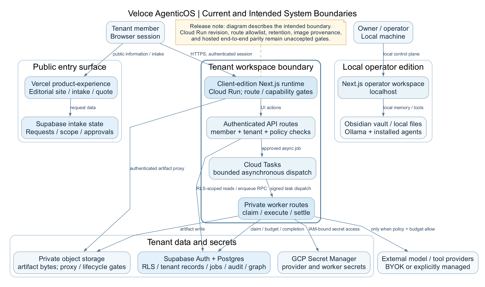

# Architecture Background

This is a reading guide to the existing design, not a new architecture or proof
of what is deployed.

[Diagram source](../architecture/agentos-system-design-architecture.dot) and
[canonical system design](../architecture/agentos-system-design-2026-10-14.md).

## Intended operating loop

1. A member signs in and the server resolves active tenant membership.
2. Approved source material enters a validated, provenance-preserving intake.
3. The runtime checks capability, policy, consent and a bounded budget.
4. A durable job is queued and a private worker claims it before external work.
5. The worker executes bounded stages, records usage and settles known costs.
6. Artifacts remain private and carry source and producing-job references.
7. A human reviews the applicable output before consequential delivery/export.
8. Audit and release evidence tie claims to source/configuration identity.

Unknown usage is not a zero-cost result. A failed settlement cannot become a
successful job. A ready storage object does not, by itself, authorize download.
These are local implementation invariants with focused tests; they do not prove
universal human approval, provider-side spending caps or hosted acceptance.
Room inline transcripts/directives and atomic domain/job reconciliation remain
separate review gaps.

## Implementation map

| Boundary | Repository entry points |
|---|---|
| Public intake and billing | `product-experience/src/app/api/billing/` |
| Authenticated tenant API | `src/app/api/client-auth/`, `src/app/api/client-runtime/` |
| Asynchronous execution | `src/app/api/internal/client-runtime/jobs/route.ts` |
| Provider accounting | `src/lib/clientProviderAdapter.ts`, `src/lib/loopCostLedger.ts` |
| Reviewed artifacts | `src/lib/clientArtifactReview.ts`, `src/components/ClientNotebookWorkspace.tsx` |
| Tenant database contracts | `product-experience/supabase-client-*.sql` |
| Source-pack/graph intake | `scripts/import-skool-register-graph.mjs`, `src/lib/clientSourcePack.ts` |
| Release evidence | `scripts/verify-production-readiness.mjs`, `scripts/lib/working-tree-fingerprint.mjs` |

## Trust and retention boundaries

The tenant edition must not expose the operator's laptop, private vault or
filesystem. Supabase-backed records, private object storage, worker credentials
and provider access have distinct authorization boundaries. Do not substitute a
different hosted service or tenant merely because it has the same UI title.

The selected tenant policy is 28 active days from original creation, followed by
seven recovery-only days, with verified final deletion required. Re-upload or
restore must not restart the original deadline. Local migrations and tests do
not prove that hosted tables, storage, backups and vendors honor that policy.
The historical selected-runtime check observed 14 active days, not the required
28. No remediation or deployed parity is claimed by this pack.
